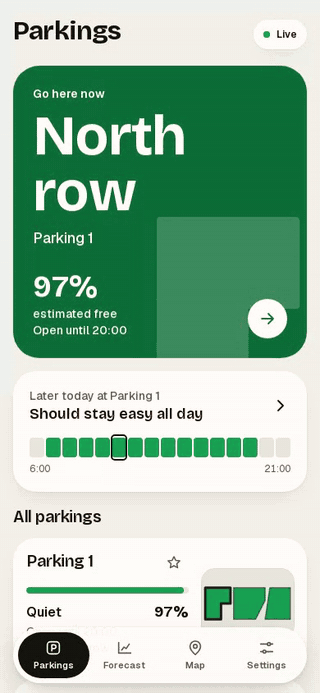
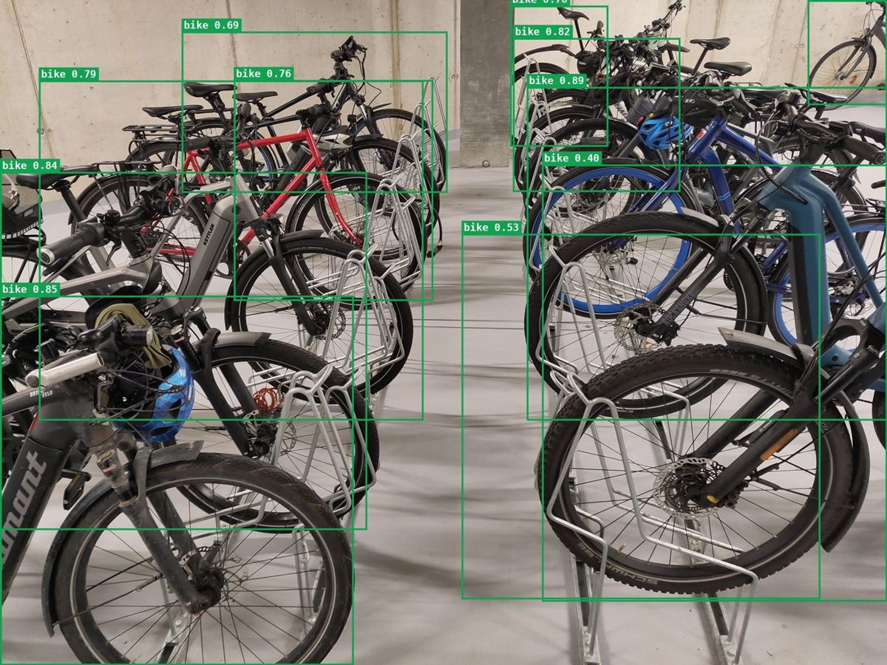
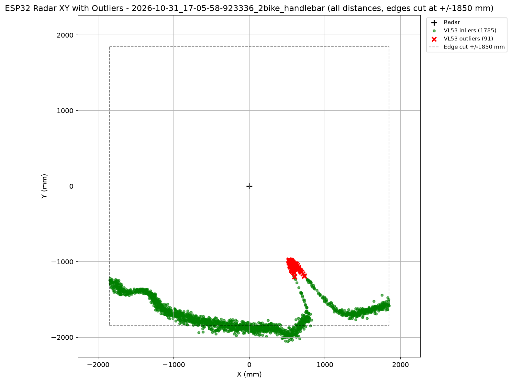
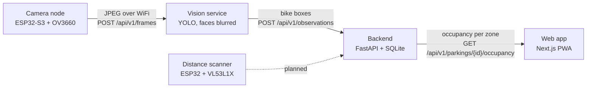
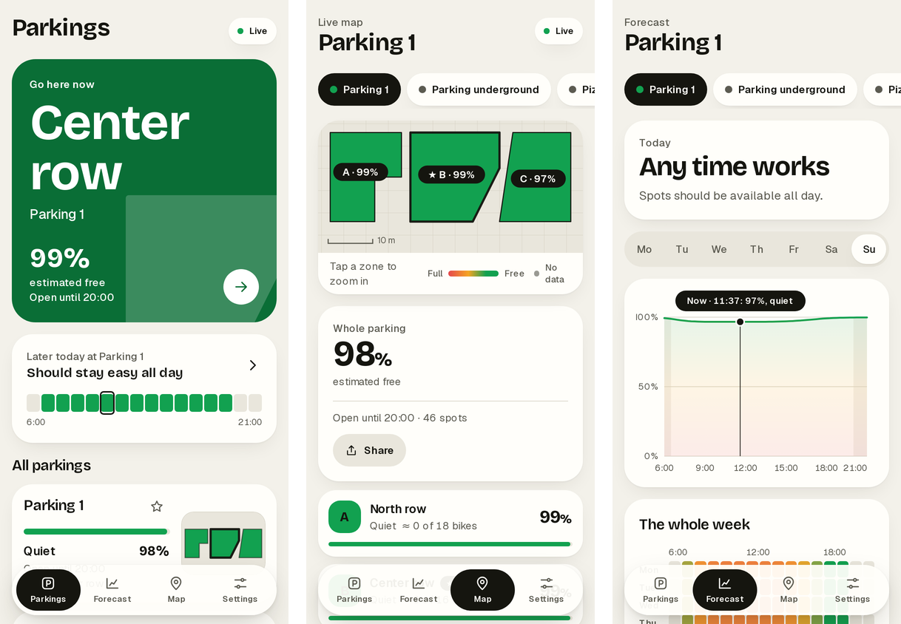

# Find my Bike Slot

[](https://github.com/FelixWeik/BaselHack_FindMyBikeSlot_RockPaperScissors/actions/workflows/ci.yml)
[](license.txt)

**Know where to park your bike before you get there.** Small sensors watch a bike rack, and a web app
shows which zones still have space, live and as a forecast.

Built in one weekend at BaselHack 2026, for the Endress+Hauser challenge, by team Rock Paper Scissors.

<p align="center">
  
  &nbsp;&nbsp;
  
</p>

## The problem

Bike parking at stations and campuses is full at peak times. You walk every row looking for a gap, park
somewhere you shouldn't, or miss your train. Nobody knows where the free spots are until they've seen them.

## Two ways to see a bike

| | Camera | Distance scanner (lidar) |
|---|---|---|
| Hardware | Seeed XIAO ESP32-S3 Sense with an OV3660 camera | ESP32 with a VL53L1X time-of-flight sensor on a stepper, sweeping 170° |
| How it finds bikes | a YOLO model, fine-tuned for crowded racks | scans the empty rack once, then anything that sticks out of the wall is a bike |
| Strengths | cheap, one camera covers a whole row | sees no faces at all, works in the dark |
| Limits | darkness, snow, things that aren't bikes, filming rules | one row per scanner, prototype |
| Code | [`code/firmware`](code/firmware), [`code/vision`](code/vision) | [`code/Hardware/ESP32_Rotating_Distance_Measurement`](code/Hardware/ESP32_Rotating_Distance_Measurement), [`code/backend/lidar`](code/backend/lidar) |
| Status | running end to end | detection works on recorded scans, not yet connected to the backend |

<p align="center">
  
  <br><sub>A lidar scan from above: the wall of the rack in blue, two bikes as red dents. How it works: <a href="documentation/lidar_ransac_outliers.md">documentation/lidar_ransac_outliers.md</a>.</sub>
</p>

### The camera model

A stock YOLO model is trained on street scenes and misses most bikes in a tight row. We fine-tuned YOLO26n on
COCO bikes, 1'200 motorbikes as "not a bike", our own photos from the Endress+Hauser bike parking, the
hand-labelled [Smart Bike Rack](https://universe.roboflow.com/free-projects/smart-bike-rack-pou2z-wwess/dataset/1)
dataset and 1'800 synthetic racks, all degraded to look like the cheap camera.

| Rack test set: 20 photos, 141 bikes | stock YOLO26n | ours |
|---|---|---|
| precision | 0.716 | **0.894** |
| recall | 0.716 | **0.901** |
| mean count error per photo | 1.20 | **0.65** |

How it was trained and what it wasn't tested on: [`code/vision/training/README.md`](code/vision/training/README.md).

## How it works



1. **Camera node** (`code/firmware`): sends JPEGs over WiFi, recovers on its own from WiFi loss, hangs and
   crashes, and can be updated over the air.
2. **Vision service** (`code/vision`): finds the bikes and sends only their boxes on. Faces are blurred in the
   one image that leaves it: the admin's calibration view.
3. **Backend** (`code/backend`): stores the parkings, puts each bike in its zone, and merges several cameras
   into one occupancy per zone.
4. **Web app** (`code/frontend`): live map, a recommendation where to go, a forecast by time of day and week,
   and an admin view to draw zones and place cameras. It installs on a phone like an app.

Interfaces: [`documentation/api.md`](documentation/api.md). Design decisions:
[`documentation/architecture.md`](documentation/architecture.md).

<p align="center">
  
</p>

## Try it

You need [uv](https://docs.astral.sh/uv/) and [Bun](https://bun.sh/). No camera needed:

```bash
git clone https://github.com/FelixWeik/BaselHack_FindMyBikeSlot_RockPaperScissors.git
cd BaselHack_FindMyBikeSlot_RockPaperScissors
scripts/start.sh --demo
```

This starts the backend, the vision service, the web app and simulated cameras, and prints the URLs. A simulated
camera sends real photos through the same route as a camera node, so what you see is what the model finds in them,
errors included.

Only the app, on made-up data: `cd code/frontend && bun install && bun run dev`, then open http://localhost:3000.

With your own camera node: flash it once ([`code/firmware/README.md`](code/firmware/README.md)), it joins the WiFi
and finds the vision service on its own. More setups, including a teammate's laptop:
[`documentation/team-setup.md`](documentation/team-setup.md).

<details>
<summary>Each service by hand, and the checks CI runs</summary>

Requirements: [uv](https://docs.astral.sh/uv/), [Bun](https://bun.sh/), [PlatformIO](https://platformio.org/).

```bash
# Backend (http://localhost:8000/docs)
cd code/backend
uv sync
uv run uvicorn app.main:app --host 0.0.0.0 --port 8000

# Vision service
cd code/vision
uv sync --group model
MDNS_HOSTNAME=bikeslot uv run --group model uvicorn app.main:create_app --factory --host 0.0.0.0 --port 8001

# Web app (http://localhost:3000), against the backend, at an address a phone can reach too
cd code/frontend
bun install
MOCK_MODE=false BACKEND_INTERNAL_URL=http://127.0.0.1:8000 bun run dev

# Camera node
cd code/firmware
cp include/secrets.h.example include/secrets.h   # WiFi credentials
pio run -t upload
```

```bash
cd code/backend  && uv run ruff check . && uv run pytest
cd code/vision   && uv run ruff check . && uv run pytest
cd code/frontend && bun run lint && bun run build
cd code/firmware && pio run
```

</details>

## Privacy by design

- Images never leave memory: no frame is written to disk on the camera, the vision service or the backend.
  Capturing training images is a separate, explicit opt-in for the team's own test setup.
- Only the parking configuration is stored. Bike positions stay in memory for a few seconds.
- Users never see a camera image. An admin calibrating a camera gets one view with its faces blurred by
  [Deface](https://github.com/ORB-HD/deface), or nothing if that fails. Blurring can miss a face: it reduces
  the risk, it doesn't remove it.
- No identification or tracking of people or bikes; the system only counts occupancy.
- The distance scanner goes further: it measures distances only and never records an image.

## Status

| Component | Status |
|---|---|
| Camera node firmware | working on hardware |
| Vision service: detection, blurred calibration view | working, tested |
| Bike model | trained; see `code/vision/training/README.md` for what it was and wasn't measured on |
| Backend: zones, occupancy, several cameras per zone | working, tested |
| Web app | working; live against the backend, or on made-up data for offline demos |
| Distance scanner | hardware and detection work on recorded scans; not yet sending to the backend |
| Forecast | simulated: the backend keeps no history yet |
| Authentication | none: this is a prototype, keep it on a trusted network |

## What's next

- Connect the distance scanner to the backend, so a zone can mix cameras and scanners.
- An all-in-one scanner on battery and solar that you screw onto a rack and forget.
- Keep a history of occupancy, so the forecast is learned instead of simulated.

## Repository layout

```
code/
  firmware/   ESP32-S3 camera node (PlatformIO, Arduino)
  vision/     bike detection service (YOLO), blurred calibration view, model training
  backend/    FastAPI service, zones and occupancy, pytest suite; lidar/ holds the scan analysis
  frontend/   Next.js progressive web app
  Hardware/   distance scanner firmware, camera test sketch, recorded lidar scans
  types/      shared TypeScript types for parking geometry and occupancy
documentation/
  api.md                    component interfaces
  architecture.md           architecture and design decisions
  lidar_ransac_outliers.md  how the scanner finds bikes
  team-setup.md             running it on your own laptop
  media/                    images for this page
assets/       photos, lidar data and plots
```
## Future / Half-Completed Research

The team put significant effort into replacing the camera node with a lidar node.
This means the software no longer relies on a machine learning model, using a simpler threshold metric instead.
Therefore, we would not need to train a model that is fixed in its detection capabilities (e.g. bikes only).

Also, one could build an all-in-one device containing the lidar sensors, powered by battery and solar, leaving us with a screw-on / screw-off device.
The hardware and software already exists - The only remaining step is to actually build it

## Team

[Aber-58](https://github.com/Aber-58) ·
[Elnix90](https://github.com/Elnix90) ·
[FelixWeik](https://github.com/FelixWeik) ·
[LuckyTheCookie](https://github.com/LuckyTheCookie) ·
[Nynferid](https://github.com/Nynferid) ·
[Weftus](https://github.com/Weftus) ·
[Corentin250000](https://github.com/Corentin250000)

## License

[MIT](license.txt). The Smart Bike Rack dataset is CC BY 4.0, see
[`code/vision/training/README.md`](code/vision/training/README.md).
